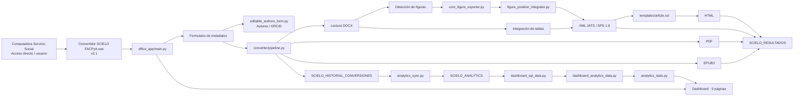
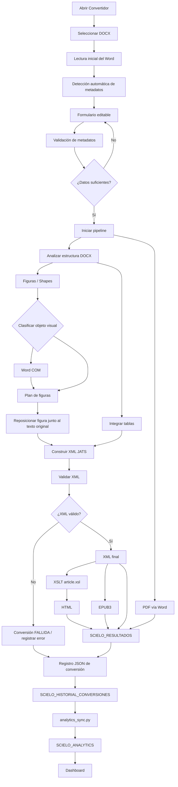
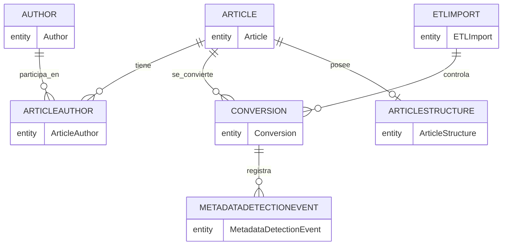
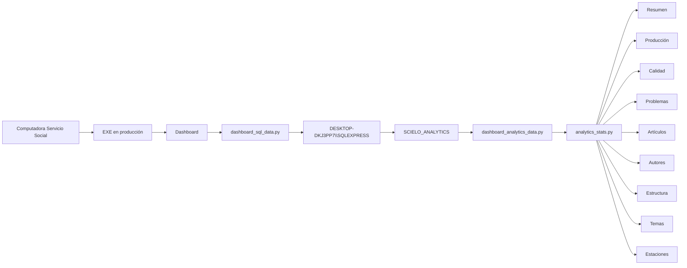
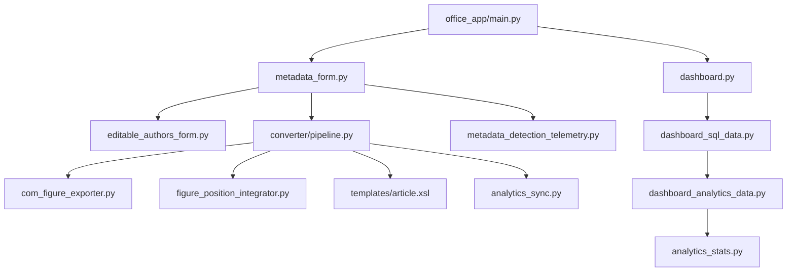
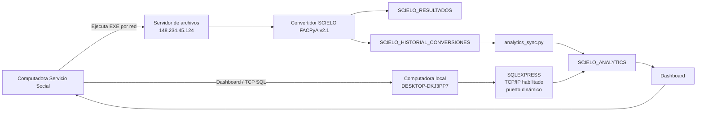

# SCIELO_XML v2.1 — Documentación técnica del proyecto

**Estado de la versión:** producción aprobada  
**Release final:** `SCIELO_XML_RC_2027_V21_FINAL_20260911_170013`  
**Rollback conservado:** `SCIELO_XML_RC_2027_FINAL_POST_PILOTO_APROBADO_20260828_174840`  
**Aplicación productiva:** `\\148.234.45.124\Secretaria de Investigacion\Convertidor SCIELO FACPyA`  
**Base analítica:** `SCIELO_ANALYTICS` en `DESKTOP-DKJ3PP7\SQLEXPRESS`

> Nota de red: TCP/IP de SQLEXPRESS está habilitado. La instancia usa puerto dinámico. El puerto observado después del último reinicio fue **64954**; este número puede cambiar después de reiniciar SQL Server. La validación de conectividad del Dashboard desde la **computadora Servicio Social** continúa como tarea operativa de infraestructura y no como defecto del convertidor.

## 1. Objetivo y alcance

SCIELO_XML automatiza la transformación de artículos científicos en Microsoft Word hacia un paquete editorial compuesto por XML JATS/SPS 1.9, HTML, PDF, EPUB3 e imágenes de figuras. Integra captura y corrección de metadatos, tratamiento de tablas y figuras, validación, publicación de resultados, historial técnico y analítica mediante SQL Server.

La solución se divide en tres capas funcionales:

- **Front-End:** interfaz de captura, validación, autores/ORCID y Dashboard.
- **Back-End:** conversión DOCX → XML/HTML/PDF/EPUB, tratamiento de figuras/tablas y publicación.
- **Analítica:** sincronización de historial hacia `SCIELO_ANALYTICS` y visualización en Dashboard.

## 2. Arquitectura general Front-End / Back-End

## 3. Flujo completo de conversión

## 4. Modelo entidad–relación lógico

El modelo siguiente se mantiene deliberadamente a nivel lógico. Los nombres exactos de columnas, tipos y restricciones físicas deben documentarse directamente desde el esquema SQL para evitar inventar detalles.

### Estado validado de tablas

| Tabla | Registros validados |
|---|---:|
| Article | 12 |
| Author | 31 |
| ArticleAuthor | 33 |
| Conversion | 5 |
| ArticleStructure | 12 |
| ETLImport | 17 |
| MetadataDetectionEvent | 0 |

`MetadataDetectionEvent = 0` es un estado válido cuando todavía no existen eventos reales de intervención sobre metadatos.

## 5. Arquitectura del Dashboard

El Dashboard tiene nueve páginas: **Resumen, Producción, Calidad, Problemas, Artículos, Autores, Estructura, Temas y Estaciones**.

Los warnings históricos schema v1 se presentan como **“Advertencias históricas sin clasificación”** y no se mezclan con incidencias clasificadas actuales.

## 6. Mapa de componentes principales

## 7. Arquitectura física y despliegue

### Rutas operativas

- Producción: `\\148.234.45.124\Secretaria de Investigacion\Convertidor SCIELO FACPyA`
- Resultados: `\\148.234.45.124\Secretaria de Investigacion\SCIELO_RESULTADOS`
- Historial: `\\148.234.45.124\Secretaria de Investigacion\SCIELO_HISTORIAL_CONVERSIONES`
- SQL: `DESKTOP-DKJ3PP7\SQLEXPRESS`
- Base: `SCIELO_ANALYTICS`

## 8. Subsistema de figuras

La versión v2.1 utiliza una ruta conservadora para objetos visuales:

1. Detecta figuras y composiciones del DOCX.
2. Mantiene compatibilidad con etiquetas históricas del documento fuente, pero la salida editorial visible se normaliza a **Figura/Figuras**.
3. Para composiciones de Shapes flotantes utiliza Microsoft Word COM.
4. Word se mantiene minimizado durante la exportación que requiere visibilidad.
5. `figure_position_integrator.py` reubica cada figura junto al texto correspondiente mediante el `source_caption` normalizado.
6. El XML final conserva `<fig>` dentro del cuerpo del artículo; las figuras ya no se concentran en `floats-group`.

## 9. Tablas, XML y HTML

El pipeline integra tablas después de las figuras y posteriormente reubica ambos elementos en el orden original del manuscrito.

Secuencia crítica:

1. Integrar figuras.
2. Integrar tablas.
3. Mover figuras a su posición original.
4. Mover tablas.
5. Validar XML.
6. Generar HTML mediante `article.xsl`.

El XSL procesa explícitamente `p | table-wrap | fig | sec | list | disp-formula`.

## 10. Metadatos y ORCID

La interfaz permite completar y corregir metadatos antes de convertir. El panel ORCID de v2.1 presenta candidatos no asignados con acción **Copiar**, sin asignación automática, mutación de selección ni validación secundaria.

La telemetría de detección de metadatos distingue:

- `DETECTED_UNCHANGED`
- `COMPLETED_MANUALLY`
- `CORRECTED`
- `CLEARED`
- `AMBIGUOUS`
- `AMBIGUOUS_RESOLVED`
- `AUTHOR_ADDED_MANUALLY`

No se almacenan nombres, correos, ORCID o DOI crudos en esta telemetría.

## 11. Modelo de almacenamiento

### Datos operativos

`SCIELO_RESULTADOS` conserva los paquetes publicados por artículo:

- XML
- HTML
- PDF
- EPUB
- IMAGENES

`SCIELO_HISTORIAL_CONVERSIONES` conserva los registros JSON de conversiones y constituye la fuente para la sincronización analítica.

### Datos analíticos

`analytics_sync.py` sincroniza el historial hacia `SCIELO_ANALYTICS`. La telemetría de metadatos se almacena separadamente y no se mezcla con KPIs de warnings/errors.

## 12. QA y regresión aprobada

### Artículo 1189

- Conversión real desde interfaz: PASS
- Word minimizado: PASS
- XML: PASS
- HTML: PASS
- PDF: PASS
- EPUB: PASS
- Figuras HTML: 6/6
- Figuras XML inline: 6/6
- Figuras en `floats-group`: 0
- Imágenes físicas: 6/6
- “Cómo citar”: revista y `12(1)` en cursiva
- Conversión desde producción: PASS

### Artículo 1390

- Ruta real resuelta: PASS
- Exportador productivo: PASS
- Figuras: 11/11
- PNG válidos y no vacíos: PASS
- Hashes únicos: 11/11

## 13. Release y rollback

Release final:

`SCIELO_XML_RC_2027_V21_FINAL_20260911_170013`

SHA del árbol de la RC v2.1:

`04CE2F0F5E6BA10E8B4FCFCAE696399559860262B266FBA80E48C85757D263AC`

EXE aprobado:

`F4003A635C5875ADA6DA890BC198C29B581A54350F4168CA985F19BDA7F77890`

Rollback v2.0:

`SCIELO_XML_RC_2027_FINAL_POST_PILOTO_APROBADO_20260828_174840`

SHA del árbol rollback:

`D66700B025381D16F148FCCEF536AD21B217481738387EF0FC92D6782F44DC8B`

No deben eliminarse ni sobrescribirse:

- RC v2.0 de rollback
- RC v2.1 final
- `SCIELO_HISTORIAL_CONVERSIONES`
- `SCIELO_RESULTADOS`
- `SCIELO_ANALYTICS`

## 14. Conectividad multiestación

La conversión y el Dashboard son subsistemas distintos. Una computadora remota puede ejecutar correctamente la conversión desde el EXE de red y, al mismo tiempo, no mostrar datos del Dashboard si no puede llegar a SQL Server.

Estado de infraestructura documentado:

- **Computadora local:** `DESKTOP-DKJ3PP7`
- SQL: `SQLEXPRESS`
- TCP/IP: habilitado
- `ListenOnAllIPs`: 1
- Puerto dinámico observado después del último reinicio: **64954**
- El puerto puede cambiar tras reiniciar SQL Server mientras la instancia mantenga configuración dinámica.

Siguiente validación operativa: desde la **computadora Servicio Social**, probar `Test-NetConnection DESKTOP-DKJ3PP7 -Port 64954`.

## 15. Solución de problemas

### El Dashboard funciona localmente pero no en otra computadora

1. Confirmar resolución de `DESKTOP-DKJ3PP7`.
2. Confirmar el puerto dinámico actual de SQLEXPRESS.
3. Probar TCP desde la computadora Servicio Social.
4. Solo si falla TCP, revisar Firewall de Windows para el puerto real.
5. Si TCP funciona pero SQL no autentica, revisar Windows Authentication y permisos.
6. Si la conexión SQL directa funciona pero el Dashboard no, revisar la cadena de conexión de la aplicación.

### Las figuras aparecen al final

Revisar `figure_position_integrator.py`, el orden del pipeline y que `article.xsl` incluya `fig` en `apply-templates`.

### Word aparece en primer plano

La ruta productiva requiere visibilidad COM para algunos Shapes; v2.1 minimiza la ventana en los puntos críticos en lugar de ocultarla completamente.

## 16. Estado final

- Desarrollo: 100%
- Release v2.1: 100%
- Producción: aprobada
- PILOTO: retirado
- Rollback v2.0: conservado
- Validación funcional de producción: aprobada
- Validación multiestación del Dashboard: en curso como tarea de infraestructura
